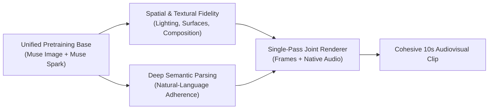

# Muse Video: Aesthetic Research & The *Atelier 10s* Prompt System

## 1. How Muse Generates Video

**Muse Video**, developed by **Meta Superintelligence Labs (MSL)**, is a frontier text-to-video and image-to-video model engineered around three architectural pillars that directly shape its visual output:



### Core Technical Pillars
1. **Shared Pretraining Base with Muse Image:** Rather than training a siloed video pipeline from scratch, Muse Video extends the spatial, textural, and compositional pretraining of *Muse Image* across the temporal dimension. It also benefits from the semantic reasoning foundations of *Muse Spark*, allowing it to parse nuanced, multi-clause directorial prompts in plain natural language without needing "tag soup."
2. **Single-Pass Native Audio Synthesis:** Unlike silent video models that require post-production foley, Muse Video renders visual frames and synchronized audio (ambient room tone, diegetic sound effects, music beds, or speech) **simultaneously in one pass**. The soundscape is structurally entangled with the visual atmosphere.
3. **Multimodal & Image-to-Video Continuity:** Because of its shared image backbone, Muse Video natively supports image-to-video motion planning and multi-reference conditioning—allowing creators to lock a still keyframe's lighting, palette, or subject identity while directing the 10-second motion arc in text.

---

## 2. Drawing Out Muse's Visual Aesthetic

Muse Video's aesthetic is not locked to a single hyper-glossy CGI look. Instead, its lineage from *Muse Image* gives it **editorial clarity, tactile surface fidelity, and adaptable lighting**, while its early temporal constraints define clear creative guardrails.

| Dimension | Where Muse Excels (Lean In) | Known Constraints (Design Around) |
| :--- | :--- | :--- |
| **Texture & Detail** | Fine organic surfaces (linen, wet stone, steam, ceramic glaze, glass refraction, skin pores, film grain). | Overly dense, chaotic crowds or tiny background text in motion. |
| **Camera & Motion** | Slow, deliberate choreography: locked-off tripod frames, gentle dolly-ins, subtle handheld breath, unhurried tracking shots. | High-velocity action, whip-pans, rapid collisions, or erratic physics (prone to temporal warping/jitter). |
| **Lighting & Color** | Motivated, directional lighting (chiaroscuro, overcast window light, golden hour halation, neon wet-street reflections) and photochemical film grades. | Generic buzzwords (*"stunning 4K masterpiece"*) that push the model toward sterile commercial stock footage. |
| **Native Audio** | Continuous, atmospheric diegetic soundscapes (room tone, rain on glass, wind in grass, kettle steam, soft textile/ceramic foley). | Rapid dialogue lip-sync or fast, staccato percussive hits (prone to micro-level A/V sync drift). |
| **Narrative Pacing** | **One primary subject** undergoing **one evolving micro-action** across a 10-second arc. | Multi-cut montages or multiple competing actions inside a single 10-second window. |

> [!TIP]
> **The Golden Rule for Artistic Muse Clips:** Treat Muse Video like a **35mm/16mm cinema camera on a slow dolly**, not an action VFX rig. Give it rich surfaces, motivated light, a single unhurried human or natural gesture, and a continuous ambient soundscape.

---

## 3. The *Atelier 10s* Prompt System

To consistently achieve a refined, gallery-grade artistic look in 10-second Muse Video clips, structure every prompt across **six modular layers** in strict natural-language order:

```text
[1. Format & Optical Signature]
[2. Camera Choreography (Single, Positive Move)]
[3. Subject, Materiality & Set Design]
[4. 10-Second Micro-Arc: 0–3s Stillness → 3–7s Inflection → 7–10s Resonance]
[5. Motivated Light, Atmosphere & Photochemical Grade]
[6. Native Audio Bed (Continuous Diegetic Sound)]
```

### Layer-by-Layer Vocabulary Matrix

#### Layer 1 — Format & Optical Signature
Anchor the lens physics before describing the scene.
- **Aspect & Framing:** `16:9 widescreen cinema frame`, `4:3 archival academy frame`, `9:16 vertical editorial portrait`
- **Optics:** `50mm vintage prime lens, shallow depth of field`, `35mm anamorphic lens, subtle oval bokeh`, `85mm portrait lens, soft falloff`, `100mm macro lens`

#### Layer 2 — Camera Choreography
State **one** deliberate move using positive phrasing (avoid *"no camera shake"*—state *"locked-off tripod"* or *"gliding gimbal"* instead).
- `Locked-off static tripod composition`
- `Imperceptibly slow dolly forward`
- `Gentle, steady lateral tracking glide`
- `Subtle, intimate handheld breathing drift`
- `Slow, meditative tilt upward`

#### Layer 3 — Subject & Materiality
Pair **one** focal subject with 2–3 tactile materials that invite light interaction:
- *Surfaces:* `unbleached raw linen`, `hand-thrown matte stoneware`, `rain-streaked leaded glass`, `weathered travertine`, `oxidized brass`, `brushed wool`, `translucent rice paper`
- *Micro-elements:* `rising steam`, `floating dust motes`, `rippling water caustics`, `wind-brushed tall grass`, `flickering candle flame`

#### Layer 4 — The 10-Second Micro-Arc
Divide the 10 seconds into three quiet beats so Muse maintains temporal permanence:
- **`[0–3s]` Establishment:** Baseline posture, environmental rhythm, stillness.
- **`[3–7s]` The Inflection:** One unhurried physical shift (pouring, turning toward light, lifting a hand, a cloud passing over sun, a ripple spreading).
- **`[7–10s]` The Resonance:** Quiet resolution and lingering visual hold.

#### Layer 5 — Motivated Light & Photochemical Grade
Always name the **light source, direction, quality, and film/grade anchor**:
- **Wabi-Sabi Daylight:** `Soft diffused northern window light, gentle shadow roll-off, shot on Kodak Portra 400, muted earth and alabaster palette, fine organic grain.`
- **Chiaroscuro Salon:** `Single warm directional tungsten key from off-frame left, deep velvety shadows, subtle halation on highlights, shot on 35mm Kodak Vision3 500T.`
- **Nocturne Rain:** `Cool sodium-vapor and muted cyan streetlamps refracting through wet glass, atmospheric mist, desaturated slate and amber cinema grade, soft anamorphic flare.`
- **16mm Pastoral:** `Low golden-hour backlight grazing through mist, warm amber rim light, shot on 16mm Ektachrome, nostalgic warmth, delicate organic film grain.`
- **Editorial Brutalism:** `Crisp high-angle architectural sunlight casting sharp geometric shadows across raw concrete, cool neutral monochrome-leaning palette, high micro-contrast.`

#### Layer 6 — Native Audio Bed
Design for **continuous, immersive texture** rather than lip-sync:
- `AUDIO: Quiet intimate room tone, soft rustle of linen, distant muffled rain against glass, no music.`
- `AUDIO: Subtle wooden floorboards creaking, gentle trickle of hot tea into stoneware, faint morning wind outside.`
- `AUDIO: Deep ambient city hum muffled by glass, steady rainfall pattering, faint distant tram bell.`

### Optional: Image-to-Video Style-Lock Protocol
When absolute identity or palette consistency is required across a series of 10-second clips:
1. Generate a master still frame in **Muse Image** using Layers 1, 3, and 5.
2. Upload the still as Reference Image 1 in **Muse Video**.
3. Prefix your text prompt with: *"Preserve the exact lighting, film grain, and color palette of Image 1. Execute the following 10-second motion and audio arc:"* followed by Layers 2, 4, and 6.

---

## 4. Three Ready-to-Run 10-Second Artistic Clips

These three prompts are engineered directly from the *Atelier 10s* system to showcase Muse Video's highest aesthetic ceiling across three distinct artistic moods.

### Clip 1 — *Morning Ceramic* (Wabi-Sabi Daylight)
> **Prompt:**
> `16:9 widescreen cinema frame, 50mm vintage prime lens with shallow depth of field. Imperceptibly slow dolly forward. In a quiet, minimalist Kyoto studio with plastered lime walls, a ceramicist's weathered hands rest beside a hand-thrown matte stoneware teapot and an unbleached linen cloth on a dark cedar table. [0-3s] Soft tendrils of steam drift lazily from the teapot spout through floating dust motes. [3-7s] The hands unhurriedly lift the stoneware pot and pour a slender, glistening arc of pale green tea into a handmade cup. [7-10s] The pot settles gently back onto the cedar table as the tea surface stills and catches the light. Soft diffused northern window light from camera left, gentle shadow roll-off, muted earth and alabaster palette, shot on 35mm Kodak Vision3 film with fine organic grain and subtle highlight halation. AUDIO: Quiet intimate room tone, delicate sound of hot tea pouring into ceramic, soft muted clink of stoneware setting on wood, faint distant morning breeze.`

### Clip 2 — *Rain on the Sleeper Car* (Nocturne Rain)
> **Prompt:**
> `16:9 widescreen cinema frame, 35mm anamorphic lens with soft oval bokeh. Subtle, intimate handheld breathing drift. Inside a dimly lit vintage sleeper train compartment at night, a woman in a textured charcoal wool coat sits beside a rain-streaked glass window, her face in quiet three-quarter profile. [0-3s] Raindrops trace slow diagonal paths across the glass while blurred amber and cool cyan station lights glide past outside. [3-7s] She gently rests her fingertips against the cool condensation on the pane, watching the reflections shift across her eyes. [7-10s] She exhales softly, fogging a small halo on the glass as the train enters a darker stretch of pine trees. Mixed lighting of a warm low-wattage brass reading lamp inside and cool nocturnal reflections outside, desaturated slate and amber indie-cinema color grade, authentic 35mm film grain. AUDIO: Rhythmic, hushed clack of train rails, steady gentle rainfall tapping against the window glass, warm low interior compartment hum.`

### Clip 3 — *Brutalist Solstice* (Editorial Architectural Poetry)
> **Prompt:**
> `16:9 widescreen cinema frame, 35mm cinema lens, deep architectural perspective. Locked-off static tripod composition. A monumental sunlit courtyard of raw board-formed concrete and travertine stone, with a shallow mirror-still reflecting pool cutting across the foreground. [0-3s] Crisp late-afternoon sunlight casts stark geometric diagonal shadows across the concrete walls while the water remains perfectly glassy. [3-7s] A solitary figure in a flowing ivory silk trench coat walks unhurriedly across the far edge of the courtyard, their elongated shadow stretching across the stone and rippling softly in the pool's reflection as a light breeze disturbs the water. [7-10s] The figure exits the right frame edge, leaving the courtyard empty as the water ripples slowly settle back into stillness. High-contrast golden architectural sunlight, warm sandstone and cool concrete palette, restrained high-fashion editorial aesthetic, subtle 35mm film grain, crisp micro-contrast. AUDIO: Expansive open-air courtyard ambience, soft echoing footsteps on stone, gentle whisper of wind skimming across water.`
